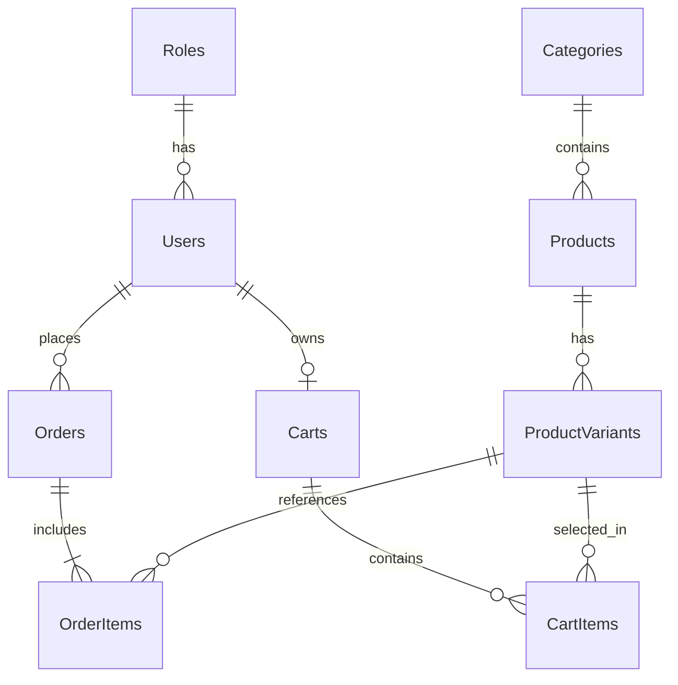

# ERD - ClothingShopDB

## Mô tả quan hệ

- Roles - Users: một vai trò có nhiều người dùng.
- Users - Orders: một người dùng có thể đặt nhiều đơn hàng.
- Users - Carts: mỗi người dùng có tối đa một giỏ hàng.
- Categories - Products: một danh mục có nhiều sản phẩm.
- Products - ProductVariants: một sản phẩm có nhiều phiên bản.
- Orders - OrderItems: một đơn hàng có nhiều dòng chi tiết.
- ProductVariants - OrderItems: một phiên bản có thể xuất hiện trong nhiều đơn hàng.
- Carts - CartItems: một giỏ hàng có nhiều dòng sản phẩm.
- ProductVariants - CartItems: một phiên bản có thể nằm trong nhiều giỏ hàng.

